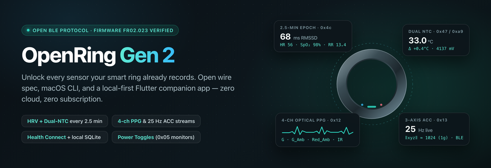
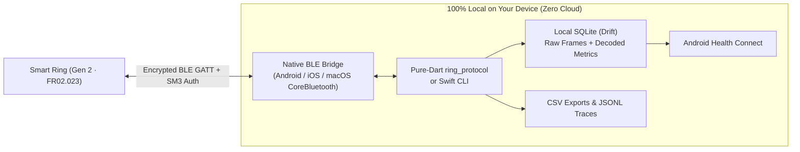

<p align="center">
  
</p>

<h3 align="center">Own every sensor reading your smart ring already records.<br>Open BLE protocol spec, macOS CLI, Python decoders, and a local-first Flutter companion app.</h3>

<p align="center">
  Free · 100% Local BLE · No account · No cloud · Compatible with RingConn Gen 2 (<code>FR02.023</code>)
</p>

<p align="center">
  <a href="LICENSE"></a>
  <a href="PROTOCOL.md"></a>
  <a href="https://github.com/saassteve/openring-gen2/actions/workflows/checks.yml"></a>
  <a href="app/"></a>
</p>

<p align="center">
  <a href="#the-outcome-what-you-unlock">The Outcome</a> ·
  <a href="#what-you-get">What You Get</a> ·
  <a href="#how-it-works">Architecture</a> ·
  <a href="#quick-start">Quick Start</a> ·
  <a href="#hardware-verification--safety">Safety</a> ·
  <a href="PROTOCOL.md">Protocol Spec</a> ·
  <a href="#disclaimer--trademarks">Disclaimer</a>
</p>

---

## Why this exists

Smart ring hardware captures rich, high-resolution physiology every 2.5 minutes — including **RMSSD HRV**, **dual-NTC skin temperature (0.05 °C)**, **respiratory rate**, **ambient light**, **motion energy**, **raw 4-channel optical PPG**, and **25 Hz 3-axis accelerometer** streams. Most of it is hidden behind a closed app, never exported, or impossible to inspect in your own tools.

**OpenRing Gen 2** documents the local Bluetooth Low Energy wire protocol and gives you ready-to-run, open-source software to talk directly to your ring — with **zero cloud, zero account, and full ownership of your raw data**.

---

## The Outcome: What You Unlock

| Capability | Stock App | OpenRing Gen 2 |
|---|:---:|:---:|
| **2.5-min HRV (RMSSD)** raw history & CSV/SQLite export | Hidden / aggregated | **Full per-epoch export** (`0x4c`) |
| **Dual-NTC skin temperature** (inner + outer, 0.05 °C) | Not exported | **15 samples / 15-min block + live `0xa9`** |
| **Respiratory rate, ambient light, MET & motion energy** | Not exposed | **Decoded per 2.5-min epoch** |
| **Live 4-channel optical PPG** (`G`, `G_Amb`, `Red_Amb`, `IR`) | Not available | **Live capture → CSV** (`0x12`, 135 B frames) |
| **Live 25 Hz 3-axis accelerometer** | Not available | **Live stream in normal mode** (`23 03 00` → `0x13`) |
| **Battery diagnostics** (exact mV, % slope, dual temp) | % icon only | **Millivolt telemetry + drain-rate charts** |
| **Background monitor power toggles** (`0x05`) | Buried / limited | **Direct toggles** (Auto-Sports, Auto BP, Sleep Pro, OSA) |
| **Android Health Connect auto-export** (HR, HRV, SpO₂, RR, Steps, Skin Temp) | Partial / manual | **Automatic after every sync (Android only)** |
| **Raw BLE command console & opcode scanner** | None | **Built into the companion app** |
| **Cloud account / telemetry required** | Yes | **None — 100% local BLE** |

---

## What You Get

Everything lives in one clean repository — pick the layer you need:

### 1. **Ring Companion** — Flutter Mobile App (`app/`)
An independent, local-first companion app for **Android** and **iOS** with native BLE bridges and a pure-Dart protocol engine:
- **Live dashboard** — heart rate, battery %, voltage (mV), wear state, dual-NTC temperatures, and `81 01` status flags (`ecoMode`, `sportsMonitor`, `monitorStatus`).
- **Sensor Lab & Always-On Automations (`Sensors` tab)** — unlocks every hardware sensor inside the ring:
  - **Always-On Ring Automations (zero extra battery)** (`0x11` hardware events + `0x10` telemetry): auto-pause media when you take the ring off, cancellable *"Don't forget your ring"* reminder, pre-bed low-battery guard with exact mV, thermal vasodilation doze-off media pause, live `ACTION_RING_EVENT` biometric broadcasts (Tasker / KWGT), and Home Assistant webhooks.
  - **Live PPG Biofeedback & Coherent Breathing** (`06 05 00` → `0x12`): real-time Green PPG waveform, beat-to-beat BPM, rolling RMSSD HRV, finger Perfusion Index (`PI%`), and a 5.5 s inhale / 5.5 s exhale breathing pacer.
  - **25 Hz Motion, Finger Gestures & System-Wide Android Control** (`23 03 00` → `0x13`): orientation-independent 3D linear-acceleration + jerk detector with live threshold sparkline, configurable sensitivity, haptic feedback, and background Android Foreground Service control across apps and screen-off (media Play/Pause/Next/Previous, volume/camera shutter, flashlight, Tasker broadcasts, Home Assistant HTTP webhooks, plus optional privacy-first Accessibility scroll/page-turn/screenshot/back).
  - **Live Dual-NTC Thermal Gradient** (`29 00 00` → `0xa9`): inner-vs-outer temperature delta as a vasodilation indicator.
  - **Hidden History Insights** (`0x4c` + `0x47`): surfaces 30-second ambient light hygiene (dark/dim/bright minutes & overnight light spikes), HRV range, and mean thermal delta.
- **History sync & local SQLite (Drift)** — drains both 2.5-minute epochs (`0x4c`) and 15-minute thermal/activity blocks (`0x47`), preserving raw frames alongside decoded records.
- **Android Health Connect auto-export *(Android only)*** — automatically writes Heart Rate, HRV (RMSSD), SpO₂, Respiratory Rate, Steps, and dual Skin Temperature series right after every history sync with idempotent cursors (can be toggled in **Settings**). On iOS, history is stored locally in SQLite and shareable from Diagnostics (Apple HealthKit is not yet integrated).
- **Power & Background Monitors panel** — toggle ring background features (`05 23` Auto-Sports, `05 25` Auto BP, `05 24` Sleep Pro PPG, `05 22` OSA) and track battery mV trends.
- **Diagnostics & Raw Command Console** — send custom hex frames, run safe opcode scans, and export JSONL BLE traces.

→ See [app/README.md](app/README.md) and [app/BLE_CHANNEL.md](app/BLE_CHANNEL.md)

### 2. **macOS CoreBluetooth CLI & Python Decoders** (`tools/`)
Zero-dependency developer tooling for Mac — compile one Swift file and talk to your ring from Terminal:
- [`tools/ringconn.swift`](tools/ringconn.swift) — scan, bond (including the macOS CoreBluetooth SMP pairing fix), authenticate via built-in SM3, stream live HR / 4-ch PPG / 25 Hz ACC, drain history, log battery curves, send custom `--cmd` hex frames, and record JSONL traces.
- [`tools/decode_history.py`](tools/decode_history.py) — converts drained traces into clean `epochs.csv` (2.5-min HR, HRV, SpO₂, RR, MET, ambient, motion) and `thermal.csv` (15-min steps, battery, 15× dual-NTC temps).
- [`tools/decode_ppg.py`](tools/decode_ppg.py) — extracts 4-channel optical PPG (`0x12`) and 25 Hz 3-axis ACC (`0x13`) frames to CSV.
- [`tools/decode_battery.py`](tools/decode_battery.py) — computes battery %/h and mV/h discharge slopes from telemetry logs.

### 3. **Hardware-Verified BLE Protocol Specification** (`PROTOCOL.md` & `docs/`)
Build your own integration (Home Assistant, Gadgetbridge, Python/Rust/Go/WebBluetooth) without starting from scratch:
- [`PROTOCOL.md`](PROTOCOL.md) — complete wire spec: GATT UUIDs, SM3 challenge-response authentication (`GB/T 32905`), TX/RX XOR framing, 38-byte `81 01` status table, 20-byte telemetry descriptor, 23-byte `0x4c` & 47-byte `0x47` record layouts, realtime `0x12`/`0x13` streams, and known hazards.
- [`docs/COMMAND-MAP.md`](docs/COMMAND-MAP.md) — full command & notification family matrix with honest hardware verification tags.
- [`docs/HARDWARE-EVIDENCE.md`](docs/HARDWARE-EVIDENCE.md) — empirical capture notes and field validations on firmware `FR02.023`.
- [`docs/MACOS-PAIRING.md`](docs/MACOS-PAIRING.md) — why naive CoreBluetooth CCCD subscription fails on macOS and the exact write-first pairing order that fixes it.

---

## How It Works



---

## Quick Start

### Option A — macOS CLI (under 60 seconds)

> **Tip:** Disconnect any other app on your phone first (the ring only holds one BLE central at a time) and wear the ring on a finger so it stays awake and advertising.

```bash
cd tools
swiftc -O ringconn.swift -o ringconn

# 1. Verify built-in SM3 implementation against known-answer vectors
./ringconn selftest

# 2. Discover nearby rings (unfiltered scan — ring advertises name only)
./ringconn --scan --seconds 30

# 3. Stream live heart rate for 60 seconds
./ringconn --name "RingConn Gen2" --live --seconds 60

# 4. Drain full history & decode to CSV (HR, HRV, SpO2, RR, dual-NTC temps, steps)
./ringconn --name "RingConn Gen2" --history --seconds 120 --trace run.jsonl
python3 decode_history.py run.jsonl out/

# 5. Use your ring as a live 25 Hz finger-gesture controller on macOS
./ringconn --name "RingConn Gen2" --gestures --seconds 300 \
  --on-double-tap "osascript -e 'tell application \"Music\" to playpause'" \
  --on-flick "osascript -e 'tell application \"Music\" to next track'"
```

Running on macOS for the first time? Read [`docs/MACOS-PAIRING.md`](docs/MACOS-PAIRING.md) — `tools/ringconn.swift` automatically writes `01 00 00` before subscribing to trigger the macOS Bluetooth pairing prompt cleanly.

### Option B — Build the Flutter Companion App

Requires Flutter 3.50+ (Dart 3.14+), Android SDK + Java 17+ for Android, or Xcode for iOS:

```bash
# Run pure-Dart protocol unit & replay tests (no Flutter required)
cd app/packages/ring_protocol
dart pub get && dart analyze && dart test

# Run full app analysis, widget/storage/exporter tests, and build debug APK
cd ../..
flutter pub get
flutter analyze
flutter test
flutter build apk --debug
# Output: app/build/app/outputs/flutter-apk/app-debug.apk
```

---

## Hardware Verification & Safety

Everything marked `verified-on-device` has been reproduced live on a physical Gen 2 ring running firmware **`FR02.023`**:

- **Verified live:** CoreBluetooth & Android bonding, SM3 auth (`81 00` → `01 01` → 38 B `81 01`), `0x05` parameter toggles (`05 23` Auto-Sports verified via `81 01` flag flip, `05 25` Auto BP), live HR (`06 01` + `95 00 00`), 4-ch PPG (`06 02` / `06 05` → `0x12`), live 25 Hz 3-axis ACC (`23 03 00` → `0x13`), dual-NTC temperature (`29 00 00` → `0xa9`), 20 B telemetry (`0x10`/`0x87`), and full two-stream history drain (`0x4c` + `0x47`).
- **Automated test suite:** 32/32 unit, protocol replay, 3D gesture DSP, SQLite migration, Health Connect exporter, device-action, command console, and widget tests passing against redacted hardware captures.

> [!WARNING]
> **Read before probing your primary ring:**
> - **Shared history pointer:** ACKing history pages (`cc 00 00` / `c7 00 00`) advances the ring's internal backlog cursor for *all* clients. Sync your primary app first if you still rely on it.
> - **Always exit live modes:** Leaving a live measurement running suppresses normal background history recording. Stop with `06 00 00` and confirm idle state via `07 00 00`.
> - **Never probe destructive opcodes** on a primary ring: `08` (System Control — `08 05` enters charger-only deep sleep), `09` (OTA bootloader), `02 01`/`02 02` (Unbound / Factory Mode), or `03` (User Bind).

---

## Repository Map

| Path | Description |
|---|---|
| [`PROTOCOL.md`](PROTOCOL.md) | Complete BLE wire protocol specification (start here) |
| [`docs/COMMAND-MAP.md`](docs/COMMAND-MAP.md) | Command & notification family matrix with verification status |
| [`docs/HARDWARE-EVIDENCE.md`](docs/HARDWARE-EVIDENCE.md) | Empirical hardware findings and record validation notes |
| [`docs/MACOS-PAIRING.md`](docs/MACOS-PAIRING.md) | macOS CoreBluetooth SMP pairing guide & stale-bond recovery |
| [`app/`](app/) | **Ring Companion** Flutter app (Android + iOS + Drift SQLite + Health Connect) |
| [`app/packages/ring_protocol/`](app/packages/ring_protocol/) | Reusable pure-Dart protocol package (zero Flutter/BLE dependencies) |
| [`tools/ringconn.swift`](tools/ringconn.swift) | Single-file macOS CoreBluetooth CLI & SM3 self-test |
| [`tools/decode_*.py`](tools/) | Python trace → CSV decoders (`history`, `ppg`, `battery`) |
| [`traces/`](traces/) | Redacted `FR02.023` captures used as test fixtures |

---

## Contributing

Open frontiers for community testing:
- Decoding `0x4f` sleep-index tables and `0x51` Sleep Pro compressed PPG sectors
- Verifying `05 22` (OSA) and `05 24` (Sleep Pro PPG) parameter toggles across firmware versions
- Testing newer Gen 2 firmware builds and Gen 3 haptics (`05 30` / `0b 03`)

Please probe read-first, tag hardware verification honestly, redact personal device IDs/serials before sharing traces, and **never** submit proprietary binaries, firmware images, or vendor assets.

---

## Disclaimer & Trademarks

- This is an **unofficial, independent open-source project** created for personal interoperability and local data access on hardware you own.
- It is **not affiliated with, endorsed by, sponsored by, or officially connected with** RingConn or Shenzhen Ninenovo Technology Co., Ltd.
- "RingConn" is a trademark of its respective owner and is used solely for nominative identification of compatible hardware.
- This repository contains **no proprietary binaries, firmware images, vendor source code, trademarked artwork, or cloud API credentials**. All software communicates exclusively over local Bluetooth Low Energy.
- Untested commands and firmware updates are used at your own risk.

## License

MIT — see [`LICENSE`](LICENSE).
